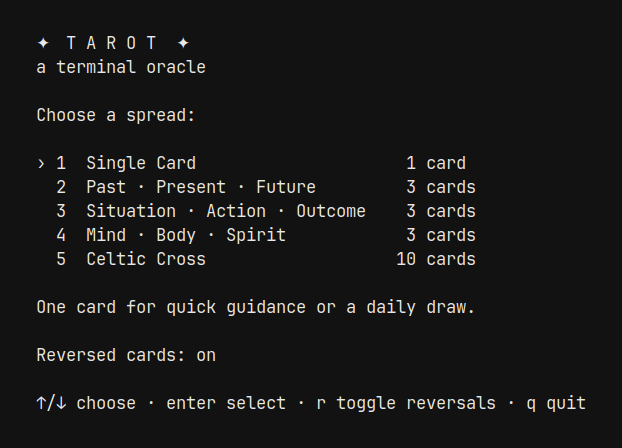
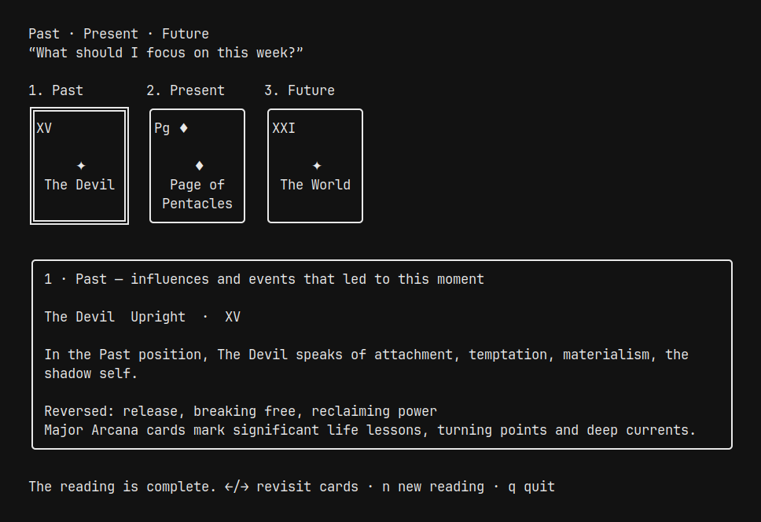

# Tarot

[](https://github.com/aneesh-pradhan/tarot/actions/workflows/ci.yml)

Tarot is a full-screen tarot reader for the terminal. You pick a spread, optionally type a question, watch the deck shuffle, and turn cards over one at a time. Every card has an upright meaning and a reversed meaning, and the reading stays on screen so you can move between positions.

It is there for a reading you can come back to. `-seed` redraws the same cards, and `-no-reversals` keeps every card upright. The layout is [Bubble Tea](https://github.com/charmbracelet/bubbletea) and [Lip Gloss](https://github.com/charmbracelet/lipgloss). It fits a classic 80×24 terminal and a wider window.

- The full 78-card deck: 22 Major Arcana and 56 Minor Arcana
- Five spreads: Single Card, Past · Present · Future, Situation · Action · Outcome, Mind · Body · Spirit, and the ten-card Celtic Cross
- Reversed cards can be switched on or off from the menu

## Screenshots

These frames are from a real session, not a mockup. The binary was `go build -o tarot .` with Go 1.26.10, then:

```sh
./tarot -seed 42
```

In the window: press `2` for Past · Present · Future, type `What should I focus on this week?`, press Enter, let the shuffle finish, then press `a` to reveal every card. That seed, with reversals left on, deals The Devil, the Page of Pentacles, and The World, all upright.

Captured in xfce4-terminal 1.1.3 (JetBrains Mono 13, background `#121212`) and cropped to the rendered frame.

### Spread menu



### Seeded reading



The Devil is selected in the Past position. Present is the Page of Pentacles. Future is The World.

## Prerequisites

Verified from a clean clone on Ubuntu 24.04.5 LTS (Linux 6.12.113+ x86_64):

| Requirement | Version |
| --- | --- |
| [Go](https://go.dev/dl/) | 1.26.10 (`go version go1.26.10 linux/amd64`) |
| Git | 2.43.0 |
| Terminal | at least 80 columns by 24 rows |

`go.mod` declares `go 1.26.10`, so the build needs that release or a newer Go. No C compiler and no libraries outside the Go module are required.

`go build` and `go test` download the modules pinned in `go.mod` and `go.sum`:

- `github.com/charmbracelet/bubbletea` v1.3.10
- `github.com/charmbracelet/lipgloss` v1.1.0
- `github.com/charmbracelet/bubbles` v0.21.1

## Setup

```sh
git clone https://github.com/aneesh-pradhan/tarot.git
cd tarot
go build -o tarot .
```

## Run

Run these in a terminal. The program takes over the screen until you quit.

```sh
./tarot
./tarot -seed 42
./tarot -no-reversals
```

`./tarot` deals at random. `-seed 42` repeats the draw in the screenshot above. `-no-reversals` starts with reversed cards turned off.

| Key | Action |
| --- | --- |
| `↑`/`↓` or `k`/`j`, or `1`–`5` | choose a spread (`1`–`5` also confirms it) |
| `r` | toggle reversed cards, on the menu |
| `enter` | confirm the spread, or start the shuffle from the question |
| `space` / `enter` | on a reading, turn the selected card, then the next face-down card |
| `←`/`→`/`↑`/`↓` or `h`/`l`/`k`/`j` | select a card and read its meaning |
| `a` | reveal all cards |
| `n` / `esc` | new reading (`esc` on the question screen goes back) |
| `q` / `ctrl+c` | quit (`esc` on the menu also quits) |

Any key during the shuffle skips the animation and deals.

## Test

```sh
go test ./...
```

## Lint

CI runs the setup build and the test command above, then:

```sh
gofmt -l .
go vet ./...
```

`gofmt -l .` prints nothing when the Go files are already formatted. The workflow is [`.github/workflows/ci.yml`](.github/workflows/ci.yml).

## License

[MIT](LICENSE). Copyright 2026 Aneesh Pradhan.
